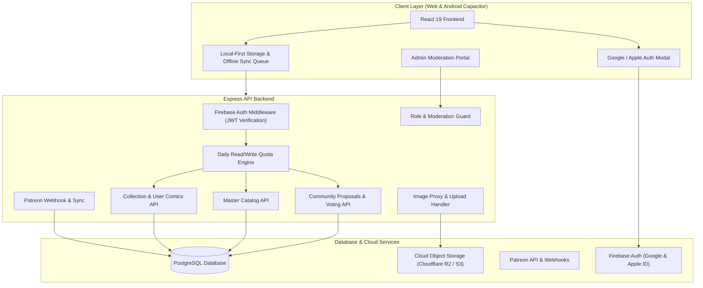
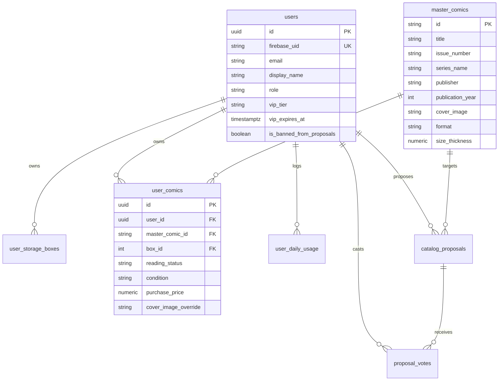

# Multi-User Architecture & Community Catalog Plan

This document outlines the end-to-end technical architecture and phased execution plan to transform **Comic Vault Box Manager** from a single-user local/cloud application into a scalable, multi-tenant platform with user authentication, personal collections, a shared canonical master catalog, daily usage quotas, VIP tiers with Patreon integration, and community voting/moderation.

---

## 1. Goal & Architecture Overview

### Key Objectives
1. **Multi-User Authentication**: Enable sign-in with **Google** and **Apple ID** using Firebase Auth, with seamless guest-mode local fallback.
2. **Catalog & Collection Separation**:
   - **Canonical Master Catalog (`master_comics`)**: High-fidelity shared comic metadata (publisher, series, issue number, release dates, creator contributions, character appearances, canonical cover art).
   - **User Collections (`user_comics`)**: User-specific data (storage box placement, condition, purchase price, user rating, read count, notes, custom tags, and personal cover image overrides).
   - **Personal Drafts**: Users can immediately add unlisted comics to their collection without waiting for global approval.
3. **Usage Quotas & Cost Guardrails**:
   - Free users get daily read/write quotas (e.g. 100 reads, 50 writes/day) tracked in UTC.
   - Exceeding quotas triggers a **soft-cap**: edits continue locally and automatically sync to the cloud when quotas reset or upon upgrading.
4. **VIP Perks & Patreon Integration**:
   - 4-Tier Ladder: **Free**, **Collector (Tier 1)**, **Archivist (Tier 2 / Highest VIP)**, and **Admin**.
   - Automatic tier assignment and expiration via Patreon OAuth & Webhooks, with a 3-day grace period and Admin manual override.
5. **Community Proposals & Voting Engine**:
   - Tier 1 VIPs can propose and vote on improved cover images.
   - Tier 2 VIPs can propose canonical metadata corrections and new master comics.
   - Automatic promotion on community quorum (+5 net votes, 70%+ approval over 3 days).
6. **Admin Moderation Portal**:
   - Super Admin (the creator) has unconditional override/veto powers, instant approval, rollback capabilities, and the ability to ban malicious users from proposals.



---

## 2. User Review Required

> [!IMPORTANT]
> **Firebase Auth Configuration**:
> To enable Apple Sign-In alongside Google, Apple Developer Service IDs, Team IDs, and Key credentials will need to be configured inside the Firebase Console. In local development and automated tests, mock auth tokens will be supported.

> [!IMPORTANT]
> **Cloud Object Storage Provider**:
> For hosting user-uploaded personal scans and community cover images, **Cloudflare R2** (S3-compatible, zero egress fees) or **AWS S3 / Firebase Storage** will be used. Direct external links (Google Drive, Imgur, CDN) remain 100% supported without storage costs.

> [!NOTE]
> **Admin Identification**:
> Your account will be automatically recognized as the Super Admin via an environment variable `ADMIN_EMAILS=your-email@example.com`. The first time you sign in with Google or Apple using that email, your account is immediately granted the `admin` role with permanent highest-tier privileges.

---

## 3. Database Schema Architecture

The existing monolithic `comic_books` and `storage_boxes` tables are separated into user-scoped collections and a global canonical catalog.



### SQL Migrations Specification

```sql
-- 1. USERS & PROFILES
CREATE TABLE IF NOT EXISTS users (
  id UUID PRIMARY KEY DEFAULT gen_random_uuid(),
  firebase_uid TEXT NOT NULL UNIQUE,
  email TEXT NOT NULL UNIQUE,
  display_name TEXT,
  avatar_url TEXT,
  role TEXT NOT NULL DEFAULT 'user' CHECK (role IN ('user', 'admin')),
  vip_tier TEXT NOT NULL DEFAULT 'free' CHECK (vip_tier IN ('free', 'collector', 'archivist')),
  vip_expires_at TIMESTAMPTZ,
  patreon_member_id TEXT,
  is_banned_from_proposals BOOLEAN NOT NULL DEFAULT FALSE,
  created_at TIMESTAMPTZ NOT NULL DEFAULT NOW(),
  updated_at TIMESTAMPTZ NOT NULL DEFAULT NOW()
);

CREATE INDEX IF NOT EXISTS idx_users_firebase_uid ON users(firebase_uid);
CREATE INDEX IF NOT EXISTS idx_users_email ON users(email);

-- 2. DAILY USAGE & RATE LIMITING
CREATE TABLE IF NOT EXISTS user_daily_usage (
  user_id UUID NOT NULL REFERENCES users(id) ON DELETE CASCADE,
  usage_date DATE NOT NULL DEFAULT (CURRENT_TIMESTAMP AT TIME ZONE 'UTC')::date,
  reads_count INTEGER NOT NULL DEFAULT 0,
  writes_count INTEGER NOT NULL DEFAULT 0,
  PRIMARY KEY (user_id, usage_date)
);

CREATE INDEX IF NOT EXISTS idx_usage_date ON user_daily_usage(usage_date);

-- 3. CANONICAL MASTER CATALOG
CREATE TABLE IF NOT EXISTS master_comics (
  id TEXT PRIMARY KEY, -- deterministic slug or csv-hash
  title TEXT NOT NULL,
  issue_number TEXT NOT NULL,
  volume TEXT,
  series_name TEXT,
  full_title TEXT,
  publisher TEXT NOT NULL,
  publication_year INTEGER,
  publication_month TEXT,
  publication_date TEXT,
  genre TEXT,
  writer TEXT,
  artist TEXT,
  cover_artist TEXT,
  creator_contributions JSONB NOT NULL DEFAULT '[]'::jsonb,
  character_appearances JSONB NOT NULL DEFAULT '[]'::jsonb,
  cover_image TEXT NOT NULL, -- canonical high-res image
  cover_image_full TEXT,
  format TEXT NOT NULL DEFAULT 'Single Issue',
  size_thickness NUMERIC(8, 2) NOT NULL DEFAULT 1.0,
  event TEXT,
  verified BOOLEAN NOT NULL DEFAULT TRUE,
  created_by_user_id UUID REFERENCES users(id) ON DELETE SET NULL,
  created_at TIMESTAMPTZ NOT NULL DEFAULT NOW(),
  updated_at TIMESTAMPTZ NOT NULL DEFAULT NOW()
);

CREATE INDEX IF NOT EXISTS idx_master_comics_title ON master_comics(title);
CREATE INDEX IF NOT EXISTS idx_master_comics_series ON master_comics(series_name);
CREATE INDEX IF NOT EXISTS idx_master_comics_publisher ON master_comics(publisher);

-- 4. USER STORAGE BOXES
CREATE TABLE IF NOT EXISTS user_storage_boxes (
  id SERIAL PRIMARY KEY,
  user_id UUID NOT NULL REFERENCES users(id) ON DELETE CASCADE,
  box_number INTEGER NOT NULL,
  name TEXT NOT NULL,
  location TEXT NOT NULL,
  max_capacity NUMERIC(8, 2) NOT NULL CHECK (max_capacity > 0),
  color_tag TEXT NOT NULL,
  notes TEXT,
  updated_at TIMESTAMPTZ NOT NULL DEFAULT NOW(),
  UNIQUE(user_id, box_number)
);

CREATE INDEX IF NOT EXISTS idx_user_boxes_user_id ON user_storage_boxes(user_id);

-- 5. USER COMIC INSTANCES
CREATE TABLE IF NOT EXISTS user_comics (
  id UUID PRIMARY KEY DEFAULT gen_random_uuid(),
  user_id UUID NOT NULL REFERENCES users(id) ON DELETE CASCADE,
  master_comic_id TEXT REFERENCES master_comics(id) ON DELETE SET NULL,
  -- For personal drafts not yet in master catalog:
  custom_metadata JSONB,
  box_id INTEGER REFERENCES user_storage_boxes(id) ON DELETE SET NULL,
  proposed_box_id INTEGER,
  reading_status TEXT NOT NULL DEFAULT 'Unread',
  copies_owned INTEGER NOT NULL DEFAULT 1 CHECK (copies_owned >= 0),
  user_rating INTEGER CHECK (user_rating BETWEEN 1 AND 5),
  condition TEXT DEFAULT 'Near Mint',
  purchase_price NUMERIC(12, 2),
  estimated_value NUMERIC(12, 2),
  read_count INTEGER NOT NULL DEFAULT 0,
  last_read_date TIMESTAMPTZ,
  cover_image_override TEXT, -- user's own cloud scan or custom link
  cover_image_full_override TEXT,
  notes TEXT,
  tags JSONB NOT NULL DEFAULT '[]'::jsonb,
  in_collection BOOLEAN NOT NULL DEFAULT TRUE,
  created_at TIMESTAMPTZ NOT NULL DEFAULT NOW(),
  updated_at TIMESTAMPTZ NOT NULL DEFAULT NOW()
);

CREATE INDEX IF NOT EXISTS idx_user_comics_user_id ON user_comics(user_id);
CREATE INDEX IF NOT EXISTS idx_user_comics_master_id ON user_comics(master_comic_id);
CREATE INDEX IF NOT EXISTS idx_user_comics_box_id ON user_comics(box_id);

-- 6. COMMUNITY PROPOSALS & VOTING
CREATE TABLE IF NOT EXISTS catalog_proposals (
  id UUID PRIMARY KEY DEFAULT gen_random_uuid(),
  proposer_id UUID NOT NULL REFERENCES users(id) ON DELETE CASCADE,
  master_comic_id TEXT REFERENCES master_comics(id) ON DELETE CASCADE,
  proposal_type TEXT NOT NULL CHECK (proposal_type IN ('cover_image', 'metadata_edit', 'new_comic')),
  proposed_changes JSONB NOT NULL,
  status TEXT NOT NULL DEFAULT 'pending' CHECK (status IN ('pending', 'approved', 'rejected', 'vetoed')),
  net_votes INTEGER NOT NULL DEFAULT 0,
  expires_at TIMESTAMPTZ NOT NULL DEFAULT (NOW() + INTERVAL '3 days'),
  reviewed_by UUID REFERENCES users(id) ON DELETE SET NULL,
  admin_notes TEXT,
  created_at TIMESTAMPTZ NOT NULL DEFAULT NOW(),
  updated_at TIMESTAMPTZ NOT NULL DEFAULT NOW()
);

CREATE INDEX IF NOT EXISTS idx_proposals_status ON catalog_proposals(status);
CREATE INDEX IF NOT EXISTS idx_proposals_master_id ON catalog_proposals(master_comic_id);

CREATE TABLE IF NOT EXISTS proposal_votes (
  proposal_id UUID NOT NULL REFERENCES catalog_proposals(id) ON DELETE CASCADE,
  user_id UUID NOT NULL REFERENCES users(id) ON DELETE CASCADE,
  vote INTEGER NOT NULL CHECK (vote IN (1, -1)),
  created_at TIMESTAMPTZ NOT NULL DEFAULT NOW(),
  PRIMARY KEY (proposal_id, user_id)
);

-- 7. AUDIT & MODERATION LOGS
CREATE TABLE IF NOT EXISTS moderation_audit_logs (
  id SERIAL PRIMARY KEY,
  actor_id UUID NOT NULL REFERENCES users(id) ON DELETE CASCADE,
  target_user_id UUID REFERENCES users(id) ON DELETE SET NULL,
  action TEXT NOT NULL, -- 'approve_proposal', 'veto_proposal', 'ban_proposals', 'tier_override'
  details JSONB NOT NULL DEFAULT '{}'::jsonb,
  created_at TIMESTAMPTZ NOT NULL DEFAULT NOW()
);
```

---

## 4. Quota Engine & VIP Tier Specifications

### Tier Permissions & Limits Table

| Feature / Quota | Free User | Tier 1: Collector (~$3/mo) | Tier 2: Archivist (~$7/mo) | Admin (Creator) |
| :--- | :--- | :--- | :--- | :--- |
| **Daily Read Requests** | 100 requests/day | 1,000 requests/day | Unlimited | Unlimited |
| **Daily Write Requests** | 50 requests/day | 500 requests/day | Unlimited | Unlimited |
| **Cloud Sync** | Enabled (with soft-cap) | Enabled | Enabled | Enabled |
| **Personal Cover Overrides** | Supported (URL + Direct Upload) | Supported (URL + Direct Upload) | Supported (URL + Direct Upload) | Supported (URL + Direct Upload) |
| **Personal Comic Drafts** | Yes (personal collection) | Yes (personal collection) | Yes (personal collection) | Yes (personal collection) |
| **Cover Proposals & Voting** | View only | Propose & Vote | Propose & Vote | Propose, Vote & Auto-Approve |
| **Metadata Proposals** | No | No | Propose & Vote | Propose, Vote & Auto-Approve |
| **Direct Catalog Edit** | No | No | No | Instant Direct Edit |
| **Veto & Rollback** | No | No | No | Full Authority |
| **User Ban / Moderation** | No | No | No | Full Authority |

### Quota Middleware Workflow
1. When an authenticated request arrives, `quotaMiddleware` checks `user_daily_usage` for today's date (UTC).
2. If the user is `free` or `collector` and exceeds their daily limit:
   - For `GET` (read operations beyond limit): returns response with header `X-Quota-Warning: Exceeded`.
   - For `POST`/`PUT`/`DELETE` (write operations): returns `429 Too Many Requests` with a JSON response:
     ```json
     {
       "error": "Daily write quota reached",
       "tier": "free",
       "limit": 50,
       "resetsAt": "2026-10-20T00:00:00Z",
       "offlineAllowed": true
     }
     ```
3. The client receives the `429` status, marks the sync queue as `paused_until_reset`, and notifies the user with a dismissible banner. Edits continue to save locally on the device and will flush to the cloud automatically at midnight UTC or if the user connects Patreon.

---

## 5. Proposed Changes by Component

### Component A: Database & Migrations
#### [NEW] `server/migrations/001_multi_user_schema.sql`
- Contains complete DDL for `users`, `user_daily_usage`, `master_comics`, `user_storage_boxes`, `user_comics`, `catalog_proposals`, `proposal_votes`, and `moderation_audit_logs`.

#### [NEW] `scripts/migrate-to-multi-user.mjs`
- One-time automated migration script:
  1. Creates all new tables.
  2. Prompts for or reads `ADMIN_EMAILS` from `.env.local`.
  3. Creates the Admin `users` record.
  4. Copies all records from existing `comic_books` into `master_comics` (canonical metadata, cover images).
  5. Inserts corresponding rows into `user_comics` linked to the Admin's `user_id`, retaining all box assignments, prices, notes, conditions, and read counts.
  6. Copies existing `storage_boxes` into `user_storage_boxes` under the Admin's `user_id`.

---

### Component B: Authentication & Security Middleware
#### [NEW] `server/middleware/auth.ts`
- Verifies Firebase ID Tokens using `firebase-admin/auth`.
- Extracts `firebase_uid` and loads or creates the user record in PostgreSQL.
- Attaches `req.user` to Express Request:
  ```typescript
  export interface AuthUser {
    id: string;
    firebaseUid: string;
    email: string;
    displayName?: string;
    role: 'user' | 'admin';
    vipTier: 'free' | 'collector' | 'archivist';
    isBannedFromProposals: boolean;
  }
  ```
- Flags admin privileges based on matching `ADMIN_EMAILS`.
- Provides `requireAuth`, `optionalAuth` (for guest/unauthenticated calls), and `requireAdmin`.

#### [NEW] `server/middleware/quota.ts`
- Tracks reads (`req.method === 'GET'`) and writes (`POST`, `PUT`, `DELETE`).
- Increments `user_daily_usage` counters with atomic `UPSERT` queries.
- Enforces soft-cap bounds according to `req.user.vipTier`.

---

### Component C: API Routes & Business Logic
#### [MODIFY] `server/routes/collection.ts`
- Scopes collection queries to `req.user.id`:
  - `GET /api/collection`: Joins `user_comics` with `master_comics`, selecting `COALESCE(uc.cover_image_override, mc.cover_image) AS cover_image`.
  - `PUT /api/comics/:id`: Updates user-owned comic instance (`user_comics`).
  - `POST /api/comics`: Adds comic instance (links to `master_comic_id`, or sets `custom_metadata` if uncataloged).
  - `DELETE /api/comics/:id`: Deletes only from `user_comics` for this user without affecting `master_comics`.

#### [NEW] `server/routes/masterCatalog.ts`
- Canonical catalog endpoints:
  - `GET /api/catalog/search?q=...`: High-speed search over `master_comics` by title, publisher, creators.
  - `GET /api/catalog/:id`: Detailed canonical comic information.
  - `POST /api/catalog/direct-edit` (Admin only): Instant master catalog updates.

#### [NEW] `server/routes/proposals.ts`
- Community voting & moderation endpoints:
  - `GET /api/proposals`: Lists active proposals with vote counts and filter by type (`cover_image`, `metadata_edit`).
  - `POST /api/proposals`: Submits a proposal (validates tier: Tier 1+ for covers, Tier 2+ for metadata; checks `is_banned_from_proposals`).
  - `POST /api/proposals/:id/vote`: Casts +1 / -1 vote (Tier 1+ required). Automatically triggers quorum check.
  - `POST /api/proposals/:id/admin-action` (Admin only): Instant `approve`, `veto`, or `rollback`.

#### [NEW] `server/routes/patreon.ts`
- Patreon integration:
  - `GET /api/patreon/auth-url`: Initiates Patreon OAuth flow.
  - `GET /api/patreon/callback`: Exchanges authorization code and links user to Patreon account.
  - `POST /api/patreon/webhook`: Validates HMAC signature, handles `members:pledge:create`, `members:pledge:update`, `members:pledge:delete`, updating `vip_tier` and `vip_expires_at`.

#### [NEW] `server/routes/storageUpload.ts`
- Generates presigned upload URLs or accepts multipart uploads to Cloudflare R2 / S3.
- Generates lightweight web-optimized thumbnails for cover overrides and proposed covers.

---

### Component D: Frontend UI & Offline Synchronization
#### [NEW] `src/context/AuthContext.tsx`
- Manages user login state with Firebase Auth (Google & Apple ID).
- Handles local session persistence and user profile data (tier, usage quotas, admin status).

#### [NEW] `src/components/AuthModal.tsx`
- Interactive modal with "Sign in with Google", "Sign in with Apple", and "Continue as Guest" buttons.
- Shows prompt to merge existing local collection when logging in.

#### [NEW] `src/components/AdminPortalModal.tsx`
- Dedicated Admin dashboard:
  - **Proposal Queue**: Visual diff of proposed cover images vs. current master image; side-by-side metadata comparisons.
  - **Audit & Rollback**: History of approved changes with one-click revert.
  - **User Management**: Search user accounts, view daily request usage, grant VIP tier overrides, and toggle proposal ban.

#### [NEW] `src/components/CommunityVotingModal.tsx`
- Community feed for VIP users to browse proposed covers and metadata corrections, preview comparisons, and cast upvotes/downvotes.

#### [MODIFY] `src/components/ComicDetailModal.tsx`
- Clean separation between:
  - **Master Information**: Publisher, Release Date, Creators, Character Appearances.
  - **My Copy Details**: Box selection, condition, rating, purchase price, personal notes.
  - **Cover Image Controls**: Displays active image with badge indicating "Using Master Cover" or "Personal Scan Override". Provides "Upload My Cover Scan" and "Propose as New Master Cover (VIP)".

#### [NEW] `src/services/syncQueueService.ts`
- Local sync queue in IndexedDB.
- When offline or when the daily quota is exhausted, queues mutations locally.
- Automatically flushes queued mutations when connection is restored and quota is available.

---

## 6. Verification Plan

### Automated Tests
1. **Schema & Migration Tests**:
   - `npm run test:migrations`: Verifies migration of existing data into `master_comics` and Admin `user_comics`.
2. **Auth & Quota Unit Tests**:
   - `npx tsx server/tests/quotaEngine.test.ts`: Tests daily quota tracking, soft-cap threshold responses (100 reads, 50 writes for Free), and reset at UTC midnight.
3. **Voting Quorum Engine Tests**:
   - `npx tsx server/tests/votingQuorum.test.ts`: Verifies that a proposal reaching +5 net votes automatically applies to `master_comics`, and tests Admin veto/rollback.
4. **Patreon Webhook Security Tests**:
   - `npx tsx server/tests/patreonWebhook.test.ts`: Validates HMAC signature verification and tier transitions.
5. **Playwright E2E Tests**:
   - `npm run test:e2e`: Verifies guest mode, signing in, creating boxes, overriding cover images, and viewing the Admin Portal.

### Manual Verification Steps
1. **Local Guest to Authenticated Transition**:
   - Open app in incognito/guest mode, add a custom comic to Box 1.
   - Click "Sign In", authenticate with Google or Apple ID.
   - Confirm prompt asks to merge local comic into the cloud account, and verify both appear in PostgreSQL.
2. **Quota Soft-Cap & Sync Queue**:
   - As a Free test user, simulate reaching 50 writes.
   - Confirm soft-cap banner displays; make a 51st edit. Verify edit displays immediately locally.
   - Reset the quota counter in PostgreSQL; verify client auto-flushes the queued edit to the server.
3. **Cover Override & Master Image**:
   - Add a comic from the master catalog; verify it shows the master cover.
   - Upload a personal cover scan; verify the user's view displays their custom image, while other users still see the canonical master cover.
4. **Community Voting & Admin Veto**:
   - As a Tier 1 user, propose a new cover image link.
   - Log in with VIP accounts and cast votes until reaching quorum (+5); verify master cover updates.
   - Log into Admin account, open Admin Portal, and execute a one-click Rollback. Verify master cover reverts.
5. **User Moderation**:
   - In Admin Portal, locate a test user and toggle "Disable Proposal Privileges".
   - Verify that test user's UI disables proposal submissions with a helpful explanation.

---

## 7. Phased Implementation Roadmap

1. **Phase 1: Database Migration & Schema Setup**
   - Implement `001_multi_user_schema.sql` and run `scripts/migrate-to-multi-user.mjs` to establish the new tables while preserving all existing collection and box data.
2. **Phase 2: Auth Middleware & User Scoping**
   - Integrate Firebase Admin JWT verification, create user session handlers, and scope collection APIs to `user_id`.
3. **Phase 3: Quota Engine & Local Sync Queue**
   - Add daily usage tracking, soft-cap rate limiting, and client-side offline mutation queuing.
4. **Phase 4: Cover Image Hosting & Personal Overrides**
   - Implement direct object upload and URL override logic with canonical master fallback.
5. **Phase 5: Community Proposals, Voting Quorum & Admin Portal**
   - Build proposal submission, voting calculation, auto-promotion, and the integrated Admin Moderation Portal.
6. **Phase 6: Patreon Webhooks & Tier Synchronization**
   - Implement Patreon OAuth and webhook listeners to automate VIP tier renewals, grace periods, and expiration dates.
