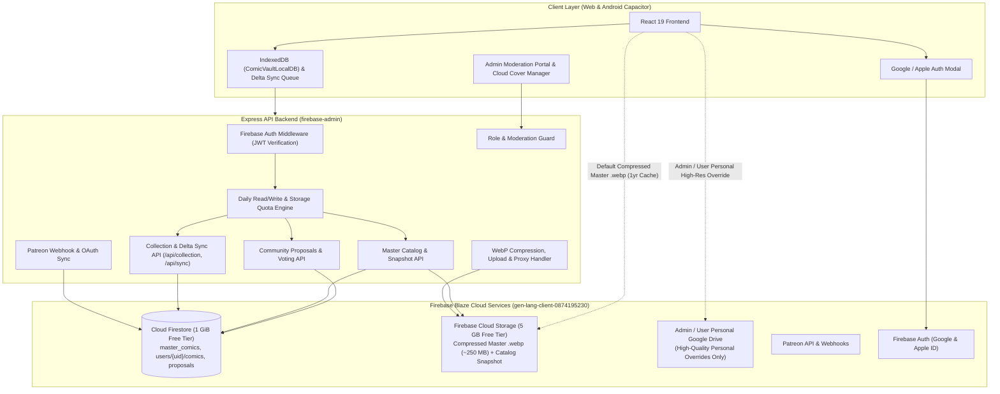
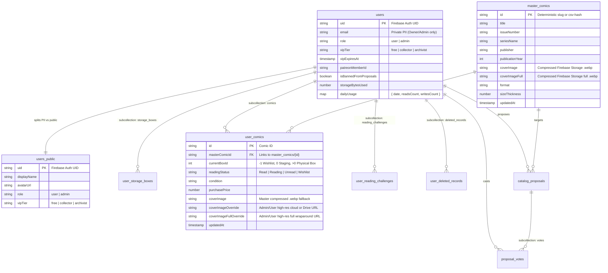

# Multi-User Architecture, Cloud Firestore & Firebase Storage Plan

This document outlines the end-to-end technical architecture and phased execution plan to transform **Comic Vault Box Manager** from a single-user PostgreSQL/Google Drive application into a scalable, multi-tenant platform backed by **Cloud Firestore** and **Firebase Cloud Storage** under the **Firebase Blaze Plan**, complete with user authentication, personal collections, a shared canonical master catalog with compressed `.webp` covers, high-quality personal cover overrides, daily usage quotas, VIP tiers with Patreon integration, and community voting/moderation.

---

## 1. Goal & Architecture Overview

### Key Objectives
/
1. **Multi-User Authentication**: Enable sign-in with **Google** and **Apple ID** using Firebase Auth, with seamless guest-mode local fallback (`IndexedDB`).
2. **Full Migration from PostgreSQL to Cloud Firestore (`1 GiB Free Tier`)**:
   - Decommission PostgreSQL as the runtime database and move all structured data into **Cloud Firestore** (`ai-studio-comicvaultboxman-f278f9f7-14a3-4b40-8c16-e78aa138625d`).
   - **Canonical Master Catalog (`master_comics` & `series_issue_totals`)**: Shared comic metadata (publisher, series, issue number, release dates, creator contributions, character appearances, and compressed canonical `.webp` cover URLs hosted in Firebase Cloud Storage).
   - **User-Scoped Subcollections (`users/{uid}/comics`, `storage_boxes`, `reading_challenges`, `deleted_records`)**: User-specific collection instances, physical boxes (preserving `Box -1` for Wishlist and `Box 0` for Unallocated/Staging per Rule 13), condition, purchase price, rating, read count, notes, tags, sync tombstones, and **personal high-quality cover image overrides** (`coverImageOverride` / `coverImageFullOverride`).
   - **Zero-Read Master Catalog Snapshot**: Publish a cached `catalog/master_catalog_snapshot.json` in Firebase Cloud Storage alongside IndexedDB delta-sync (`updatedAt > lastSyncAt`) so initial catalog loads, searches, and multi-device syncs consume near-zero Firestore document reads (protecting the 50,000 reads/day and 20,000 writes/day Blaze free tier).
3. **Two-Tier Cover Image Strategy in Firebase Cloud Storage (`5 GB Free Tier`)**:
   - **Shared Master Layer (Compressed `.webp` Only — ~200–300 MB Total)**:
     - Instead of uploading the raw **3.2 GB** folder of full-quality `.webp` files to Firebase Cloud Storage (`gen-lang-client-0874195230.firebasestorage.app`), the migration script compresses and downscales each local `.webp` into a lightweight, web-optimized `.webp` (~40–60 KB for front covers at `w=400`, ~80–120 KB for full wraparound art at `w=900`).
     - This shrinks the entire shared Master Catalog image footprint from **3.2 GB down to ~200–300 MB** (<6% of the 5 GB Blaze free tier, leaving **~4.7 GB** of free headroom) and attaches `Cache-Control: public, max-age=31536000, immutable` headers so community browsing stays well below the **1 GB/day** free download bandwidth cap.
     - Community users load these compressed Firebase Storage `.webp` covers by default—**zero external users ever access or hit the Admin's personal Google Drive**.
   - **Personal Override Layer (High-Quality Cloud Images Preserved for Admin & Users)**:
     - During migration from PostgreSQL, the Admin's existing high-quality Google Drive / cloud cover URLs are automatically saved into `coverImageOverride` and `coverImageFullOverride` on `users/{adminUid}/comics/{comicId}`.
     - Because the app resolves `userComic.coverImageOverride || masterComic.coverImage`, **the Admin continues using their full-quality cloud images** across all views, while other users see the compressed `.webp` master covers and can override any comic in their own collection with their own higher-quality images (via their own Google Drive, external URLs, or VIP uploads).
4. **Usage Quotas & Cost Guardrails**:
   - Free users get daily API sync read/write quotas (e.g., 100 sync reads, 50 writes/day) tracked in UTC on `users/{uid}.dailyUsage`.
   - Exceeding quotas triggers a **soft-cap**: edits continue locally in `IndexedDB` (`ComicVaultLocalDB`) and automatically flush to Firestore when quotas reset or upon upgrading.
5. **VIP Perks & Patreon Integration**:
   - 4-Tier Ladder: **Free**, **Collector (Tier 1)**, **Archivist (Tier 2 / Highest VIP)**, and **Admin**.
   - Automatic tier assignment and expiration via Patreon OAuth & Webhooks, with a 3-day grace period and Admin manual override.
6. **Community Proposals, Voting Engine & Admin Moderation Portal**:
   - Tier 1 VIPs can propose and vote on improved cover images (auto-compressed to `.webp` on upload; rejected/vetoed proposal files are automatically deleted from Firebase Storage).
   - Tier 2 VIPs can propose canonical metadata corrections and new master comics.
   - Automatic promotion on community quorum (+5 net votes, 70%+ approval over 3 days), with unconditional Super Admin instant approve, veto, rollback, and user proposal-ban powers.



---

## 2. User Review & Firebase Configuration

> [!IMPORTANT]
> **Firebase Blaze Plan Free-Tier Budget & Region Verification**:
> - **Cloud Storage Bucket (`gen-lang-client-0874195230.firebasestorage.app`)**:
>   - **Free Tier Allowance**: **5 GB total storage**, **1 GB/day download bandwidth**, **50,000 download ops/day**, and **20,000 upload ops/day** (applicable in eligible US regions: `us-central1`, `us-east1`, `us-west1`).
>   - **Master Catalog Compressed `.webp` Footprint**: **~200–300 MB** (compressed from your local 3.2 GB `.webp` library; the raw 3.2 GB files are **never** uploaded to Firebase Storage).
>   - **Master Catalog JSON Snapshot (`catalog/master_catalog_snapshot.json`)**: **~10 MB**.
>   - **Remaining Free Storage Headroom**: **~4.7 GB** reserved for VIP personal/proposal uploads (with automatic deletion of rejected/superseded proposal images).
> - **Cloud Firestore (`ai-studio-comicvaultboxman-f278f9f7-14a3-4b40-8c16-e78aa138625d`)**:
>   - **Free Tier Allowance**: **1 GiB stored data**, **50,000 document reads/day**, **20,000 document writes/day**, **20,000 document deletes/day**.
>   - Protected via client-side `IndexedDB` delta synchronization (`updatedAt > lastSyncAt`), denormalized user comic documents (zero N+1 reads), and initial catalog hydration from `master_catalog_snapshot.json`.

> [!IMPORTANT]
> **Firebase Admin & Auth Credentials**:
> - Configure `FIREBASE_SERVICE_ACCOUNT_KEY` (path to service account JSON or base64 JSON string) in `.env.local` so the Express server and CLI migration scripts can authenticate via `firebase-admin`.
> - To enable Apple Sign-In alongside Google, configure Apple Developer Service IDs, Team IDs, and Key credentials inside the Firebase Console. In local development and Playwright E2E tests, `window.__MOCK_AUTH__` and mock Bearer tokens remain supported.

> [!NOTE]
> **Admin Identification & High-Quality Cover Preservation**:
> - Your account is automatically recognized as the Super Admin via `ADMIN_EMAILS=your-email@example.com` in `.env.local`.
> - During the PostgreSQL-to-Firestore migration, all of your existing collection items, boxes, and **high-quality Google Drive cover links** (`coverImageOverride` / `coverImageFullOverride`) are bound to your Admin UID so your view continues rendering your full-quality cloud images while `master_comics` serves the compressed Firebase Storage `.webp` files to all other users.

---

## 3. Cloud Firestore Data Model & Security Rules

PostgreSQL tables are replaced by a structured NoSQL document hierarchy in Cloud Firestore (`ai-studio-comicvaultboxman-f278f9f7-14a3-4b40-8c16-e78aa138625d`), paired with strict PII separation (`users` vs. `users_public`) and denormalized user comic fields to avoid N+1 read multiplication.



### 3.1 Firestore Collection & Subcollection Specifications

#### 1. `users/{uid}` (Private User Profile & Quota State — Owner/Admin Read Only)
Contains sensitive account fields and quota counters. Never readable by other regular users.
```json
{
  "uid": "firebase-auth-uid-123",
  "email": "admin@example.com",
  "displayName": "Brian",
  "avatarUrl": "https://lh3.googleusercontent.com/...",
  "role": "admin",
  "vipTier": "archivist",
  "vipExpiresAt": null,
  "patreonMemberId": null,
  "isBannedFromProposals": false,
  "storageBytesUsed": 0,
  "dailyUsage": {
    "usageDate": "2026-11-10",
    "readsCount": 14,
    "writesCount": 3
  },
  "createdAt": "2026-11-10T18:00:00.000Z",
  "updatedAt": "2026-11-10T18:00:00.000Z"
}
```

#### 2. `users_public/{uid}` (Public Non-PII Profile)
Used for displaying proposer names/badges in the Community Proposals & Voting feed without exposing email addresses or private quota/Patreon metadata.
```json
{
  "uid": "firebase-auth-uid-123",
  "displayName": "Brian",
  "avatarUrl": "https://lh3.googleusercontent.com/...",
  "role": "admin",
  "vipTier": "archivist",
  "updatedAt": "2026-11-10T18:00:00.000Z"
}
```

#### 3. `master_comics/{comicId}` (Canonical Shared Master Catalog)
Stores canonical bibliographic metadata, contributor/character arrays (migrated from `title_contributors` and `title_character_appearances`), market valuation estimates, and **only compressed `.webp` Firebase Cloud Storage URLs** (`covers/master/{comicId}.webp` and `covers/master-full/{comicId}.webp`).
```json
{
  "id": "csv-8f92a1bc04d2e319a871b2c4",
  "title": "The Amazing Spider-Man",
  "issueNumber": "300",
  "volume": "1",
  "seriesName": "The Amazing Spider-Man",
  "fullTitle": "The Amazing Spider-Man #300",
  "publisher": "Marvel Comics",
  "publicationYear": 1988,
  "publicationMonth": "5",
  "publicationDate": "1988-05-01",
  "genre": "Superhero",
  "writer": "David Michelinie",
  "artist": "Todd McFarlane",
  "coverArtist": "Todd McFarlane",
  "creatorContributions": [
    { "creatorName": "David Michelinie", "roleName": "Writer" },
    { "creatorName": "Todd McFarlane", "roleName": "Penciller" }
  ],
  "characterAppearances": [
    { "characterName": "Spider-Man (Peter Parker)", "appearanceType": "Main" },
    { "characterName": "Venom (Eddie Brock)", "appearanceType": "First Appearance" }
  ],
  "coverImage": "https://firebasestorage.googleapis.com/v0/b/gen-lang-client-0874195230.firebasestorage.app/o/covers%2Fmaster%2Fcsv-8f92a1bc04d2e319a871b2c4.webp?alt=media",
  "coverImageFull": "https://firebasestorage.googleapis.com/v0/b/gen-lang-client-0874195230.firebasestorage.app/o/covers%2Fmaster-full%2Fcsv-8f92a1bc04d2e319a871b2c4.webp?alt=media",
  "format": "Single Issue",
  "sizeThickness": 1.0,
  "event": null,
  "estimatedValue": 450.0,
  "valueSource": "PriceCharting",
  "valueUpdatedAt": "2026-11-10T00:00:00.000Z",
  "verified": true,
  "createdByUserId": "firebase-auth-uid-123",
  "createdAt": "2026-11-10T18:00:00.000Z",
  "updatedAt": "2026-11-10T18:00:00.000Z"
}
```

#### 4. `series_issue_totals/{seriesVolumeKey}` (Canonical Series Issue Counts)
Deterministic ID (`slugify(seriesName + '__vol_' + volume)`), storing `publisher`, `seriesName`, `volume`, `issueCount`, and `updatedAt`.

#### 5. `users/{uid}/storage_boxes/{boxId}` (User Storage Boxes)
Scoped per user. Always initializes system containers `id = -1` (`Box -1: Wishlist`) and `id = 0` (`Box #0: Unallocated / Staging Queue`) alongside physical boxes (`1..N`) to uphold Rule 13.

#### 6. `users/{uid}/comics/{comicId}` (User Comic Instances with Denormalized Display Metadata & High-Quality Overrides)
Stores user-owned or wishlisted comic state alongside denormalized bibliographic fields (`title`, `issueNumber`, `seriesName`, `publisher`, `coverImage`, etc.) so delta sync (`GET /api/collection` and `POST /api/sync`) reads only changed documents in `users/{uid}/comics` without N+1 queries against `master_comics`.
- **Two-Tier Cover Resolution**:
  - `masterCoverImage` / `masterCoverImageFull`: The compressed `.webp` URL from `master_comics` (Firebase Cloud Storage).
  - `coverImageOverride` / `coverImageFullOverride`: Optional high-quality personal override URL (for the Admin, this preserves all existing high-res Google Drive cover links from PostgreSQL; for other users, this stores their own Google Drive, external URL, or VIP cloud upload).
  - The API and client resolve `coverImage = coverImageOverride || masterCoverImage || 'NoImage.webp'` and `coverImageFull = coverImageFullOverride || masterCoverImageFull`.

#### 7. `users/{uid}/deleted_records/{entityType_entityId}` (Delta Sync Tombstones)
Replaces the PostgreSQL `deleted_records` table per user (`entityType: 'comic' | 'box'`, `entityId`, `deletedAt` ISO string) so `POST /api/sync` propagates deletions across a user's PC and Android phone (Rule 10).

#### 8. `users/{uid}/reading_challenges/{challengeId}` (User Reading Challenges)
Stores the user's active/completed reading challenges, criteria snapshots, eligible items, and milestone completion timestamps.

#### 9. `catalog_proposals/{proposalId}` & Subcollection `votes/{uid}`
- `catalog_proposals/{proposalId}`: `proposerId`, `proposerDisplayName`, `masterComicId`, `proposalType` (`'cover_image' | 'metadata_edit' | 'new_comic'`), `proposedChanges` (including staged Firebase Storage path `stagedStoragePath` if a cover upload), `status` (`'pending' | 'approved' | 'rejected' | 'vetoed'`), `netVotes`, `upvotesCount`, `downvotesCount`, `expiresAt`, `reviewedBy`, `adminNotes`, `createdAt`, `updatedAt`.
- `catalog_proposals/{proposalId}/votes/{uid}`: `{ uid, proposalId, vote: 1 | -1, createdAt }`.

#### 10. `moderation_audit_logs/{logId}`
Stores Admin moderation actions (`actorId`, `targetUserId`, `action`, `details`, `createdAt`) for one-click audit and rollback.

---

### 3.2 Firebase Cloud Storage Layout (`gen-lang-client-0874195230.firebasestorage.app`)

| Storage Path Pattern | Purpose | Compression & Size Target | Cache-Control Header | Who Can Write |
| :--- | :--- | :--- | :--- | :--- |
| `covers/master/{comicId}.webp` | Canonical standard front cover for `master_comics` | Compressed `.webp` (`w=400, q=75`, ~35–60 KB) | `public, max-age=31536000, immutable` | Admin & Approved Proposals |
| `covers/master-full/{comicId}.webp` | Canonical full wraparound cover for `master_comics` | Compressed `.webp` (`w=900, q=78`, ~80–120 KB) | `public, max-age=31536000, immutable` | Admin & Approved Proposals |
| `covers/users/{uid}/{comicId}.webp` | Optional VIP-hosted personal cover override | Client-compressed `.webp` (max 350 KB) | `private, max-age=31536000, immutable` | Owner (Tier 1+ VIP / Admin) |
| `covers/proposals/{proposalId}.webp` | Staged community cover proposal (auto-deleted if rejected/vetoed) | Client-compressed `.webp` (max 350 KB) | `public, max-age=86400` | Proposer (Tier 1+ VIP / Admin) |
| `catalog/master_catalog_snapshot.json` | Pre-built JSON snapshot of `master_comics` & `series_issue_totals` for 0-read hydration | JSON (~8–12 MB raw, ~1.5 MB gzipped over HTTP) | `public, max-age=300, stale-while-revalidate=86400` | Admin / Backend Server |

---

### 3.3 Prototype Firestore & Storage Security Rules (`firestore.rules` & `storage.rules`)

> [!WARNING]
> **Prototype Security Rules Notice**:
> These prototype Security Rules are designed to keep data in Cloud Firestore and Firebase Storage safe by enforcing strict owner-only PII access (`users/{uid}`), non-PII public profile separation (`users_public/{uid}`), RBAC role lockdown (preventing privilege self-escalation), strict schema & string-length validators, and path scoping. Review and verify them with `firebase deploy --only firestore:rules,storage --dry-run` before broadly sharing the app.

```javascript
// firestore.rules
rules_version = '2';
service cloud.firestore {
  match /databases/{database}/documents {

    // ===============================================================
    // Assumed Data Model & Helper Functions
    // ===============================================================
    function isAuthenticated() {
      return request.auth != null;
    }

    function isOwner(userId) {
      return isAuthenticated() && request.auth.uid == userId;
    }

    function isAdmin() {
      return isAuthenticated() &&
        exists(/databases/$(database)/documents/users/$(request.auth.uid)) &&
        get(/databases/$(database)/documents/users/$(request.auth.uid)).data.role == 'admin';
    }

    function isVipTier1OrHigher() {
      return isAuthenticated() &&
        exists(/databases/$(database)/documents/users/$(request.auth.uid)) &&
        (get(/databases/$(database)/documents/users/$(request.auth.uid)).data.vipTier in ['collector', 'archivist'] ||
         get(/databases/$(database)/documents/users/$(request.auth.uid)).data.role == 'admin');
    }

    function hasRequiredFields(fields) {
      return request.resource.data.keys().hasAll(fields);
    }

    function validStringLength(field, minLen, maxLen) {
      return request.resource.data[field] is string &&
        request.resource.data[field].size() >= minLen &&
        request.resource.data[field].size() <= maxLen;
    }

    function isValidOptionalString(field, maxLen) {
      return !(field in request.resource.data) ||
        request.resource.data[field] == null ||
        (request.resource.data[field] is string && request.resource.data[field].size() <= maxLen);
    }

    // ===============================================================
    // 1. Private User Profile (Strict Owner / Admin Read — Protects PII)
    // ===============================================================
    function isValidUserDoc(data) {
      return hasRequiredFields(['uid', 'email', 'role', 'vipTier', 'isBannedFromProposals']) &&
        data.uid is string && data.uid.size() > 0 && data.uid.size() <= 128 &&
        data.email is string && data.email.size() <= 320 &&
        data.role in ['user', 'admin'] &&
        data.vipTier in ['free', 'collector', 'archivist'] &&
        data.isBannedFromProposals is bool;
    }

    match /users/{userId} {
      allow read: if isOwner(userId) || isAdmin();
      // Prevent privilege escalation: users can only create their own doc as role=='user' and vipTier=='free'
      allow create: if isAuthenticated() && isValidUserDoc(request.resource.data) &&
        ((isOwner(userId) &&
          request.resource.data.uid == userId &&
          request.resource.data.role == 'user' &&
          request.resource.data.vipTier == 'free' &&
          request.resource.data.isBannedFromProposals == false) || isAdmin());
      // Prevent self-escalation on update: role, vipTier, isBannedFromProposals must remain unchanged unless Admin
      allow update: if isAuthenticated() && isValidUserDoc(request.resource.data) &&
        ((isOwner(userId) &&
          request.resource.data.uid == resource.data.uid &&
          request.resource.data.role == resource.data.role &&
          request.resource.data.vipTier == resource.data.vipTier &&
          request.resource.data.isBannedFromProposals == resource.data.isBannedFromProposals) || isAdmin());
      allow delete: if isAdmin();

      // User-owned subcollections (comics, storage_boxes, reading_challenges, deleted_records)
      match /comics/{comicId} {
        allow read, delete: if isOwner(userId) || isAdmin();
        allow create, update: if (isOwner(userId) || isAdmin()) &&
          hasRequiredFields(['id', 'title', 'issueNumber', 'publisher', 'readingStatus', 'currentBoxId']) &&
          validStringLength('title', 1, 500) &&
          validStringLength('issueNumber', 1, 60) &&
          validStringLength('publisher', 1, 200) &&
          isValidOptionalString('notes', 10000) &&
          isValidOptionalString('coverImageOverride', 2048) &&
          isValidOptionalString('coverImageFullOverride', 2048);
      }

      match /storage_boxes/{boxId} {
        allow read, delete: if isOwner(userId) || isAdmin();
        allow create, update: if (isOwner(userId) || isAdmin()) &&
          hasRequiredFields(['id', 'name', 'location', 'maxCapacity', 'colorTag']) &&
          validStringLength('name', 1, 200) &&
          validStringLength('location', 1, 200) &&
          isValidOptionalString('notes', 5000);
      }

      match /reading_challenges/{challengeId} {
        allow read, write: if isOwner(userId) || isAdmin();
      }

      match /deleted_records/{tombstoneId} {
        allow read, write: if isOwner(userId) || isAdmin();
      }
    }

    // ===============================================================
    // 2. Public User Profile (Non-PII Only)
    // ===============================================================
    match /users_public/{userId} {
      allow read: if isAuthenticated();
      allow create, update: if (isOwner(userId) || isAdmin()) &&
        request.resource.data.keys().hasOnly(['uid', 'displayName', 'avatarUrl', 'role', 'vipTier', 'updatedAt']) &&
        isValidOptionalString('displayName', 100) &&
        isValidOptionalString('avatarUrl', 2048);
      allow delete: if isAdmin();
    }

    // ===============================================================
    // 3. Canonical Master Catalog & Series Totals
    // ===============================================================
    match /master_comics/{comicId} {
      allow read: if isAuthenticated();
      allow write: if isAdmin();
    }

    match /series_issue_totals/{seriesKey} {
      allow read: if isAuthenticated();
      allow write: if isAdmin();
    }

    // ===============================================================
    // 4. Community Proposals & Votes
    // ===============================================================
    match /catalog_proposals/{proposalId} {
      allow read: if isAuthenticated();
      allow create: if isVipTier1OrHigher() &&
        request.resource.data.proposerId == request.auth.uid &&
        request.resource.data.status == 'pending' &&
        request.resource.data.netVotes == 0;
      allow update, delete: if isAdmin();

      match /votes/{voterUid} {
        allow read: if isAuthenticated();
        allow create, update: if isVipTier1OrHigher() &&
          isOwner(voterUid) &&
          request.resource.data.vote in [1, -1];
        allow delete: if isOwner(voterUid) || isAdmin();
      }
    }

    // ===============================================================
    // 5. Moderation Audit Logs
    // ===============================================================
    match /moderation_audit_logs/{logId} {
      allow read, write: if isAdmin();
    }
  }
}
```

---

## 4. Quota Engine, Storage Limits & VIP Tier Specifications

### Tier Permissions & Limits Table

| Feature / Quota | Free User | Tier 1: Collector (~$3/mo) | Tier 2: Archivist (~$7/mo) | Admin (Creator) |
| :--- | :--- | :--- | :--- | :--- |
| **Daily API Sync Reads** | 100 requests/day | 1,000 requests/day | Unlimited | Unlimited |
| **Daily API Sync Writes** | 50 requests/day | 500 requests/day | Unlimited | Unlimited |
| **Cloud Sync (`IndexedDB` ↔ Firestore)** | Enabled (with soft-cap) | Enabled | Enabled | Enabled |
| **Default Catalog Covers** | Compressed `.webp` from Firebase Storage | Compressed `.webp` from Firebase Storage | Compressed `.webp` from Firebase Storage | High-Quality Personal Cloud/Drive Override |
| **Personal High-Res Cover Overrides** | External URL / Personal Google Drive (`0 MB` Firebase upload) | External URL, Google Drive, or Firebase Upload (`100 MB` cap) | External URL, Google Drive, or Firebase Upload (`500 MB` cap) | Unlimited (Google Drive + Firebase Storage) |
| **Personal Comic Drafts** | Yes (`users/{uid}/comics`) | Yes (`users/{uid}/comics`) | Yes (`users/{uid}/comics`) | Yes + Instant Master Catalog Publish |
| **Cover Proposals & Voting** | View only | Propose (compressed `.webp`) & Vote | Propose (compressed `.webp`) & Vote | Propose, Vote & Instant Auto-Approve |
| **Metadata Proposals** | No | No | Propose & Vote | Propose, Vote & Instant Auto-Approve |
| **Direct Master Catalog Edit** | No | No | No | Instant Direct Edit |
| **Veto, Rollback & User Ban** | No | No | No | Full Authority |

### Quota & Delta-Sync Workflow
1. **Zero-Read Initial Catalog Hydration**:
   - When a client searches the Master Catalog or initializes for the first time, it fetches `catalog/master_catalog_snapshot.json` from Firebase Cloud Storage (cached via CDN/browser) and only queries Firestore `master_comics` where `updatedAt > snapshot.generatedAt`.
2. **Delta Collection Sync (`POST /api/sync`)**:
   - Client sends `lastSyncAt` and any queued local mutations from `IndexedDB` (`sync_outbox`).
   - Express `quotaMiddleware` checks `users/{uid}.dailyUsage` for today's UTC date (`YYYY-MM-DD`).
   - Each delta sync pull/push increments the user's daily request counter (rather than billing 1 quota point per individual comic document), while batched writes are capped per tier.
3. **Soft-Cap Offline Continuation**:
   - If a `free` or `collector` user exceeds their daily write quota, `POST /api/sync` returns `429 Too Many Requests` with `{ "error": "Daily write quota reached", "resetsAt": "...", "offlineAllowed": true }`.
   - The client keeps all edits safely in `ComicVaultLocalDB` (`IndexedDB`) and displays a non-blocking banner; queued mutations automatically sync at midnight UTC or upon Patreon tier upgrade.

---

## 5. Proposed Changes by Component

### Component A: Firebase Admin Adapter & One-Time Migration Scripts

#### [NEW] `server/firebaseAdmin.ts`
- Initializes `firebase-admin/app` using `FIREBASE_SERVICE_ACCOUNT_KEY` (or Application Default Credentials) and reads [firebase-applet-config.json](file:///D:/Projects/comic-vault-box-manager/firebase-applet-config.json):
  - `firestoreDb = getFirestore(app, firebaseConfig.firestoreDatabaseId)` (`ai-studio-comicvaultboxman-f278f9f7-14a3-4b40-8c16-e78aa138625d`)
  - `storageBucket = getStorage(app).bucket(firebaseConfig.storageBucket)` (`gen-lang-client-0874195230.firebasestorage.app`)
  - `adminAuth = getAuth(app)`

#### [NEW] `scripts/migrate-postgres-to-firestore.mjs`
- One-time automated migration script that connects to your existing local PostgreSQL database (`DATABASE_URL`) and migrates all records into Cloud Firestore in batched 450-operation `WriteBatch` commits:
  1. Resolves your Admin UID from `ADMIN_EMAILS` via Firebase Auth (or creates/links the Admin `users/{adminUid}` and `users_public/{adminUid}` documents with `role: 'admin'`, `vipTier: 'archivist'`).
  2. Reads all rows from PostgreSQL `comic_books` (including aggregated `creator_contributions` and `character_appearances` from `title_contributors` and `title_character_appearances`):
     - Writes canonical comic metadata into `master_comics/{comicId}`. (Note: Any existing Google Drive URL on `comic_books.cover_image` is **not** exposed in `master_comics.coverImage`—`master_comics.coverImage` is set to `'NoImage.webp'` until Step B populates the compressed Firebase Storage `.webp` URL, ensuring your Google Drive links are never exposed to other users).
     - Writes your personal comic instances into `users/{adminUid}/comics/{comicId}`, **preserving your existing high-quality Google Drive / cloud URLs inside `coverImageOverride` and `coverImageFullOverride`**, along with all box assignments (`currentBoxId`, with `-1` for Wishlist and `0` for Staging), `proposedBoxId`, `readingStatus`, `readCount`, `userRating`, `condition`, `purchasePrice`, `estimatedValue`, `lockEstimatedValue`, `notes`, and `tags`.
  3. Copies all rows from PostgreSQL `storage_boxes` into `users/{adminUid}/storage_boxes/{boxId}` (including `Box -1: Wishlist` and `Box 0: Unallocated / Staging Queue`).
  4. Copies all rows from PostgreSQL `series_issue_totals` into `series_issue_totals/{seriesVolumeKey}`.
  5. Copies all rows from PostgreSQL `reading_challenges` and `reading_challenge_items` into `users/{adminUid}/reading_challenges/{challengeId}`.

#### [NEW] `scripts/upload-compressed-webp-to-firebase.mjs`
- One-time CLI batch compression & upload script (`node scripts/upload-compressed-webp-to-firebase.mjs --dir "C:\path\to\your\webp-folder"`):
  1. Scans your local PC folder containing the **3.2 GB** of `.webp` comic cover images (both standard front covers and full wraparound covers).
  2. Uses the exact matching algorithms from [imageUtils.ts](file:///D:/Projects/comic-vault-box-manager/src/utils/imageUtils.ts) (`findBestMatchingComic`, `doesFileNameMatchComic`, `doesFullCoverMatchComic`, `hasFullCoverWord`) and existing comic IDs to match each `.webp` file to its target `comicId`.
  3. **Compresses without uploading full-size files**:
     - Standard front covers are resized/compressed via `sharp` to `width: 400, quality: 75` WebP (~35–55 KB each).
     - Full wraparound covers (`hasFullCoverWord`) are resized/compressed to `width: 900, quality: 78` WebP (~80–120 KB each).
     - Raw full-quality files are **never** uploaded to Firebase Cloud Storage, keeping total bucket usage around **~200–300 MB** instead of 3.2 GB.
  4. Uploads the compressed buffers to Firebase Cloud Storage at `covers/master/{comicId}.webp` (or `covers/master-full/{comicId}.webp`) with `metadata: { contentType: 'image/webp', cacheControl: 'public, max-age=31536000, immutable' }`.
  5. Updates `master_comics/{comicId}.coverImage` (and `coverImageFull`) and `users/{adminUid}/comics/{comicId}.masterCoverImage` in Cloud Firestore while **leaving `users/{adminUid}/comics/{comicId}.coverImageOverride` untouched** so your Admin account continues displaying your high-quality cloud images!
  6. Generates and uploads `catalog/master_catalog_snapshot.json` to Firebase Cloud Storage.

---

### Component B: Authentication, Quota & Security Rules

#### [NEW] `firestore.rules` & `storage.rules`
- Deploys Firestore and Cloud Storage security rules enforcing owner-only PII protection on `users/{uid}`, public non-PII access on `users_public/{uid}`, Admin-only writes on `master_comics` and `covers/master/*`, and Tier 1+ VIP scoped uploads on `covers/users/{uid}/*` and `covers/proposals/*` (enforcing `request.resource.size < 400 * 1024` and `request.resource.contentType == 'image/webp'`).

#### [NEW] `server/middleware/auth.ts`
- Verifies Firebase ID Tokens using `adminAuth.verifyIdToken(token)`.
- Loads or initializes `users/{uid}` and `users_public/{uid}` in Cloud Firestore.
- Automatically grants `role: 'admin'` and `vipTier: 'archivist'` when `user.email` matches `ADMIN_EMAILS`.
- Supports mock auth tokens in local development / Playwright test runs (`process.env.NODE_ENV !== 'production'`).

#### [NEW] `server/middleware/quota.ts`
- Checks and atomically increments `users/{uid}.dailyUsage` (`usageDate`, `readsCount`, `writesCount`) in Firestore.
- Enforces soft-cap limits for `free` and `collector` tiers, returning `429` with `offlineAllowed: true` when write limits are reached.

---

### Component C: Express API Routes Refactored from PostgreSQL to Firestore

#### [MODIFY] `server/routes/collection.ts`
- Replaces `pg` `pool.query` calls with `firestoreDb` operations scoped to `req.user.uid` (`users/{uid}/comics`, `users/{uid}/storage_boxes`, `users/{uid}/deleted_records`):
  - `GET /api/collection`: Returns the user's comics and storage boxes, resolving `coverImage: doc.coverImageOverride || doc.masterCoverImage || doc.coverImage || 'NoImage.webp'` and `coverImageFull: doc.coverImageFullOverride || doc.masterCoverImageFull || doc.coverImageFull`.
  - `POST /api/sync`: Executes bidirectional delta sync against `users/{uid}/comics`, `users/{uid}/storage_boxes`, and `users/{uid}/deleted_records` where `updatedAt > lastSyncAt`, preserving offline Wishlist-to-Owned transitions (`baseStatus === 'Wishlist'`) per Rule 9 and recording tombstones on delete per Rule 10.
  - `PUT /api/comics/:id`, `POST /api/comics`, `DELETE /api/comics/:id`: Updates `users/{uid}/comics/{id}` and records/clears tombstones in `users/{uid}/deleted_records`.

#### [NEW] `server/routes/masterCatalog.ts`
- `GET /api/catalog/snapshot`: Returns a signed/public redirect or streams `catalog/master_catalog_snapshot.json` plus any `master_comics` delta documents modified since `snapshot.generatedAt`.
- `GET /api/catalog/search?q=...`: Searches canonical `master_comics`.
- `POST /api/catalog/direct-edit` (Admin only): Updates `master_comics/{id}` directly in Firestore and triggers an asynchronous refresh of `catalog/master_catalog_snapshot.json`.

#### [NEW] `server/routes/storageUpload.ts`
- Accepts client-compressed `.webp` uploads from Tier 1+ VIPs and Admin:
  - **Admin Master Cover Upload**: Compresses and writes to `covers/master/{comicId}.webp` (or `covers/master-full/{comicId}.webp`), updates `master_comics/{comicId}`, and optionally preserves the Admin's high-res source link in `users/{adminUid}/comics/{comicId}.coverImageOverride`.
  - **VIP Personal Override Upload**: Validates `users/{uid}.storageBytesUsed` against tier cap (`100 MB` Collector / `500 MB` Archivist), uploads to `covers/users/{uid}/{comicId}.webp`, and sets `coverImageOverride` on `users/{uid}/comics/{comicId}`.
  - **VIP Proposal Cover Upload**: Uploads compressed `.webp` to `covers/proposals/{proposalId}.webp`.

#### [NEW] `server/routes/proposals.ts`
- Community voting & moderation endpoints backed by `catalog_proposals` and `moderation_audit_logs`:
  - `GET /api/proposals`: Lists pending/recent proposals with vote counts.
  - `POST /api/proposals`: Validates VIP tier (Tier 1+ for `cover_image`, Tier 2+ for `metadata_edit` / `new_comic`) and `!req.user.isBannedFromProposals`.
  - `POST /api/proposals/:id/vote`: Records `+1` / `-1` vote in `catalog_proposals/{id}/votes/{uid}` inside a Firestore transaction. If quorum is reached (`netVotes >= 5` and approval `>= 70%`), automatically promotes the change to `master_comics` (copying `covers/proposals/{proposalId}.webp` to `covers/master/{comicId}.webp` and deleting the staging object).
  - `POST /api/proposals/:id/admin-action` (Admin only): Instant `approve`, `veto`, or `rollback`. **When a cover proposal is rejected or vetoed, its staged file in `covers/proposals/{proposalId}.webp` is immediately deleted from Firebase Cloud Storage** so rejected proposals never consume storage space.

#### [NEW] `server/routes/patreon.ts`
- Handles Patreon OAuth (`GET /api/patreon/auth-url`, `GET /api/patreon/callback`) and HMAC-verified webhooks (`POST /api/patreon/webhook`), updating `vipTier` and `vipExpiresAt` in `users/{uid}` and `users_public/{uid}`.

---

### Component D: Frontend UI, Two-Tier Cover Controls & Cloud Cover Manager

#### [NEW] `src/context/AuthContext.tsx` & `src/components/AuthModal.tsx`
- Manages Firebase Auth login state (Google & Apple ID + Guest mode).
- Displays current tier badge (`Free`, `Collector VIP`, `Archivist VIP`, `Admin`) and daily sync quota status.

#### [MODIFY] [GoogleDriveCoversModal.tsx](file:///D:/Projects/comic-vault-box-manager/src/components/GoogleDriveCoversModal.tsx)
- Upgrades the navbar's `Drive Covers` modal (preserving all icon-only top-bar styling, `title`, `aria-label`, and `<span className="sr-only">` accessibility locators per Rule 2b) into a dual-mode **Cloud & Drive Cover Manager**:
  - **For Admin**:
    - When linking covers from Google Drive or a local folder, keeps the **high-quality Google Drive URL** as the Admin's personal `coverImageOverride` / `coverImageFullOverride` while compressing and uploading a lightweight `.webp` to Firebase Cloud Storage (`covers/master/`) for `master_comics`.
  - **For Regular & VIP Users**:
    - Allows linking higher-quality personal cover overrides (`coverImageOverride` / `coverImageFullOverride`) from their own Google Drive or external URLs (and direct `.webp` upload for VIPs) on top of the default compressed `.webp` master covers.

#### [MODIFY] [ComicDetailModal.tsx](file:///D:/Projects/comic-vault-box-manager/src/components/ComicDetailModal.tsx)
- Displays a clear cover source badge:
  - **"Master Catalog Cover (Compressed WebP)"**: Shown when viewing the default shared cover from Firebase Cloud Storage.
  - **"High-Quality Personal Override"**: Shown when the comic uses `coverImageOverride` (such as your Admin Google Drive covers or a user's custom high-res override).
- Provides actions to **"Override with High-Res URL / Drive / Scan"**, **"Revert to Master Cover"**, or **"Propose as Master Cover (VIP)"** (which client-side compresses the image into a lightweight `.webp` before submitting).

#### [NEW] `src/components/CommunityVotingModal.tsx` & `src/components/AdminPortalModal.tsx`
- **Community Voting Modal**: Allows VIPs to inspect proposed compressed `.webp` covers and metadata edits side-by-side and cast votes.
- **Admin Moderation Portal**: Provides instant one-click Approve, Veto (with automatic Firebase Storage cleanup), Rollback from `moderation_audit_logs`, and User Management (VIP tier override and proposal ban toggle).

---

## 6. Verification Plan

### Automated Tests
1. **PostgreSQL-to-Firestore & Compressed WebP Migration Dry-Run Tests**:
   - `npx tsx server/tests/firestoreMigration.test.ts`: Verifies that `comic_books` records split cleanly into `master_comics` (compressed Firebase Storage `.webp` URLs, zero Google Drive exposure) and `users/{adminUid}/comics` (preserving the Admin's original high-quality Google Drive URLs in `coverImageOverride` and `coverImageFullOverride`, plus `Box -1` Wishlist and `Box 0` Staging invariants).
2. **Auth, Quota & Delta Sync Unit Tests**:
   - `npx tsx server/tests/quotaEngine.test.ts`: Tests daily quota tracking in `users/{uid}.dailyUsage`, soft-cap `429` responses (100 sync reads, 50 writes for Free), and UTC midnight reset.
3. **Voting Quorum & Storage Cleanup Tests**:
   - `npx tsx server/tests/votingQuorum.test.ts`: Verifies that a proposal reaching +5 net votes promotes to `master_comics`, and verifies that rejecting/vetoing a cover proposal deletes `covers/proposals/{proposalId}.webp` from Firebase Storage.
4. **Security Rules Validation**:
   - `npx -y firebase-tools@latest deploy --only firestore:rules,storage --dry-run`: Validates syntax and compilation of `firestore.rules` and `storage.rules`.
5. **Playwright E2E Tests**:
   - Build production bundle (`npm run build`) per Rule 15 and run `npm run test:e2e` to verify guest mode, authenticated sync, high-quality cover overrides, and Admin Portal workflows.

### Manual Verification Steps
1. **Verify Admin High-Quality Override vs. Community Compressed Master Cover**:
   - Run `scripts/migrate-postgres-to-firestore.mjs` and `scripts/upload-compressed-webp-to-firebase.mjs`.
   - Log in as **Admin**: inspect a comic in `CollectionCatalog` and `ComicDetailModal` and confirm it loads your **high-quality Google Drive image** via `coverImageOverride`.
   - Log in as a **second non-admin test user**: view the same comic in the Master Catalog / their collection and confirm the image URL points to `gen-lang-client-0874195230.firebasestorage.app/o/covers%2Fmaster%2F...webp` (~45 KB compressed `.webp`) with **zero requests to `drive.google.com` or `lh3.googleusercontent.com`**.
2. **Verify Bucket Footprint in Firebase Console**:
   - Check Firebase Console → Storage and confirm total bucket usage for all master covers + full wraparound covers is **~200–300 MB** (well below the 5 GB Blaze free tier limit).
3. **Verify User High-Res Override**:
   - As a regular user, paste an external high-res image URL (or link a personal Google Drive file) on a comic's `coverImageOverride`; confirm the user sees their high-res override while the shared `master_comics` cover remains unchanged.
4. **Verify Community Proposal & Admin Veto Cleanup**:
   - As a Tier 1 VIP test user, propose a cover image; as Admin, click **Veto** in the Admin Portal and verify the staged `.webp` file is deleted from `covers/proposals/`.

---

## 7. Phased Implementation Roadmap

1. **Phase 1: Firebase Admin Setup, Security Rules & PostgreSQL-to-Firestore Migration**
   - Implement `server/firebaseAdmin.ts`, `firestore.rules`, `storage.rules`, and `scripts/migrate-postgres-to-firestore.mjs` to migrate all PostgreSQL tables into Cloud Firestore while preserving your high-quality cloud URLs in `users/{adminUid}/comics.coverImageOverride`.
2. **Phase 2: Batch Local `.webp` Compression & Upload to Firebase Cloud Storage**
   - Implement and run `scripts/upload-compressed-webp-to-firebase.mjs` to compress your 3.2 GB `.webp` library into ~200–300 MB of lightweight `.webp` master covers in Firebase Cloud Storage, link them to `master_comics`, and generate `catalog/master_catalog_snapshot.json`.
3. **Phase 3: Express API Refactor to Firestore, Auth Middleware & Quota Engine**
   - Refactor `server/routes/collection.ts`, `challenges.ts`, `importsAndExports.ts`, and `valuation.ts` from `pg` to `firestoreDb`, and add `auth.ts` and `quota.ts` middleware.
4. **Phase 4: Two-Tier Cover Override UI & Upgraded Cloud/Drive Cover Manager**
   - Update `ComicDetailModal.tsx` and `GoogleDriveCoversModal.tsx` so Admin and users can manage high-quality personal overrides (`coverImageOverride`) alongside compressed Firebase Storage master covers.
5. **Phase 5: Community Proposals, Voting Quorum & Admin Moderation Portal [COMPLETED]**
   - Implemented `server/services/proposalEngine.ts` and `server/services/proposalService.ts` with pure permission rules, voting quorum math (+5 net votes, >=70% approval), auto-promotion to `master_comics`, and automatic Cloud Storage cleanup of rejected/vetoed staged files (`covers/proposals/*`).
   - Implemented `server/routes/proposals.ts` with endpoints for proposal creation, voting, admin approve/reject/veto/rollback, user moderation, and audit logs.
   - Built client service `src/services/proposalClientService.ts` and frontend modals `CommunityVotingModal.tsx` and `AdminPortalModal.tsx`.
   - Wired Community Voting and Admin Portal into `Navbar.tsx` (preserving icon-only density and full accessibility per Rule 2b) and `App.tsx`.
   - Integrated "Propose Master Cover (VIP)" action into `ComicDetailModal.tsx`.
   - Added automated unit test suite `server/tests/votingQuorum.test.ts` (`npm run test:proposals`), verifying quorum promotion, storage deletion on veto, and admin rollback.
6. **Phase 6: Patreon OAuth & Webhook Tier Synchronization**
   - Implement `server/routes/patreon.ts` to automate Collector (Tier 1) and Archivist (Tier 2) VIP status in Firestore.
